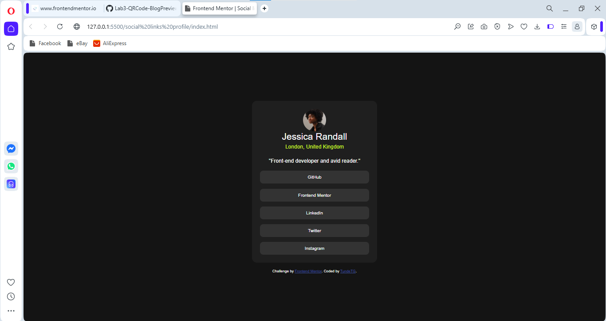

# Frontend Mentor - Social links profile solution

This is a solution to the [Social links profile challenge on Frontend Mentor](https://www.frontendmentor.io/challenges/social-links-profile-UG32l9m6dQ). Frontend Mentor challenges help you improve your coding skills by building realistic projects. 

## Table of contents

- [Overview](#overview)
  - [The challenge](#the-challenge)
  - [Screenshot](#screenshot)
  - [Links](#links)
- [My process](#my-process)
  - [Built with](#built-with)
  - [What I learned](#what-i-learned)
  - [Continued development](#continued-development)
  - [Useful resources](#useful-resources)
  - [AI Collaboration](#ai-collaboration)
- [Author](#author)
- [Acknowledgments](#acknowledgments)

## Overview

### The challenge

Users should be able to:

- See hover and focus states for all interactive elements on the page

### Screenshot

### Links

- Solution URL: [Solution URL](https://github.com/aknb-ii/Social-link-profile)
- Live Site URL: [Live site URL](https://aknb-ii.github.io/Social-link-profile/)

## My process

### Built with

- Semantic HTML5 markup
- CSS custom properties
- Flexbox

**Note: These are just examples. Delete this note and replace the list above with your own choices**

### What I learned
 Nothing new

### Continued development

- Better ways to optimize coding for ease.

### Useful resources

- [SuperSimpleDev](https://www.youtube.com/results?search_query=supersimpledev+html%2B+css+course) - This video really helped with learning HTML+ CSS.
- [Programming with Mosh](https://www.youtube.com/results?search_query=programming+with+mosh+html+course) - This is one of the videos i watched to learn HTML.

### AI Collaboration

Gemini: I used Gemini to remember some forgotten process in uploading code to github.
## Author

- Frontend Mentor - [@TundeTheGreat](https://www.frontendmentor.io/profile/TundeTheGreat)
- Twitter - [@aknb_ii](https://www.twitter.com/aknb_ii)

## Acknowledgments

I thank God for his Grace.
Special thanks to SuperSimpleDev & Programming with Mosh on YouTube for their free videos on HTML & CSS.
